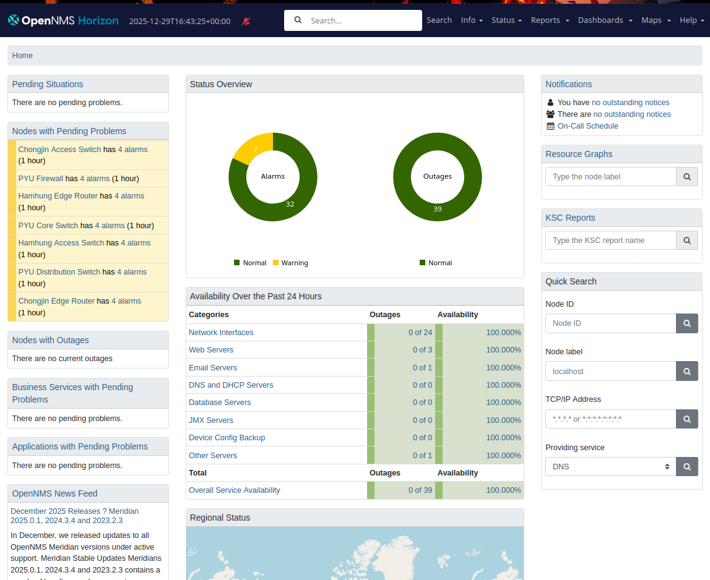

# OpenNMS PYU Monitoring Lab

> **Fictional case study.** "Pyongyang University (PYU)" is a fictional three-campus university used as the case study for the COM615 Network Management module at Southampton Solent University. No real organisation, network or data is involved: every system runs as a container in a local lab.


**COM615 Network Management - Pyongyang University Infrastructure Monitoring**

## Overview

This repository contains a complete distributed network monitoring solution using OpenNMS Horizon for Pyongyang University's three-campus infrastructure.

| Component | Details |
|-----------|---------|
| **OpenNMS Version** | Horizon 33.0.2 |
| **Monitored services** | 39 (dashboard, 29 December 2025) |
| **Campuses** | Pyongyang (CIOC), Hamhung, Chongjin |
| **Minions** | 2 (distributed collectors) |

## Architecture
```
                    ┌─────────────────────────────────────┐
                    │       Pyongyang CIOC (Main)         │
                    │  ┌─────────────────────────────┐    │
                    │  │   OpenNMS Horizon 33.0.2    │    │
                    │  │   PostgreSQL 14             │    │
                    │  │   ActiveMQ 5.18.3           │    │
                    │  └─────────────────────────────┘    │
                    └──────────────┬──────────────────────┘
                                   │
              ┌────────────────────┼────────────────────┐
              │                    │                    │
              ▼                    ▼                    ▼
    ┌─────────────────┐  ┌─────────────────┐  ┌─────────────────┐
    │ Hamhung Campus  │  │ Pyongyang Local │  │ Chongjin Campus │
    │ Minion Collector│  │ Infrastructure  │  │ Minion Collector│
    │ 6 nodes         │  │ 14 nodes        │  │ 6 nodes         │
    └─────────────────┘  └─────────────────┘  └─────────────────┘
```

## Quick Start

### First-time setup
All credentials are local lab defaults supplied via `.env`, which is never committed. Change them before any non-lab use.
```bash
cp .env.example .env     # then set your own values
./render-config.sh       # builds the OpenNMS and LDAP config files from their templates
```

### Start Lab
```bash
~/pyu-opennms_lab/start-opennms-lab.sh
```

### Stop Lab
```bash
~/pyu-opennms_lab/stop-opennms-lab.sh
```

### Access URLs

| Service | URL | Credentials |
|---------|-----|-------------|
| OpenNMS | http://localhost:8980/opennms | set in `.env` |
| VLE | http://localhost:8081 | - |
| DNS/DHCP | http://localhost:8083 | - |
| Semaphore | http://localhost:8084 | set in `.env` |
| LDAP Admin | http://localhost:8085 | - |
| ActiveMQ | http://localhost:8161 | set in `.env` |

## Directory Structure
```
pyu-opennms_lab/
├── horizon/              # OpenNMS Horizon + PostgreSQL + ActiveMQ
├── minions/
│   ├── hamhung/          # Hamhung campus Minion
│   └── chongjin/         # Chongjin campus Minion
├── ldap/                 # OpenLDAP authentication
├── dns-dhcp/             # DNS and DHCP services
├── semaphore/            # Ansible automation UI
├── fog/                  # FOG imaging server
├── vle/                  # Virtual Learning Environment
├── network-devices/      # Simulated network infrastructure
├── simulated-devices/    # SNMP simulators
├── requisitions/         # OpenNMS node requisitions
├── screenshots/          # Evidence for COM615 report
├── start-opennms-lab.sh  # Startup script (~5 min)
└── stop-opennms-lab.sh   # Shutdown script
```

## Results

The OpenNMS dashboard captured on 29 December 2025 (16:43 UTC) shows **100% service availability over the preceding 24 hours** across 39 monitored services, with no outages. These figures come from the simulated lab, not production traffic.



Service targets were detection within 10 minutes, repair within 45 minutes and availability of at least 97%. Detection and repair times were not measured in this lab.

## Team

| Member | Role |
|--------|------|
| Jose Vasconcelos | OpenNMS Monitoring & Alerting |
| Bigyan | Ansible Automation |
| Biloliddin | VMware/Kubernetes Virtualisation |
| Sebastian | Network Security |

## Author

**Jose Vasconcelos (KariocaMarron)**  
COM615 Network Management  
Southampton Solent University  
January 2026

---
